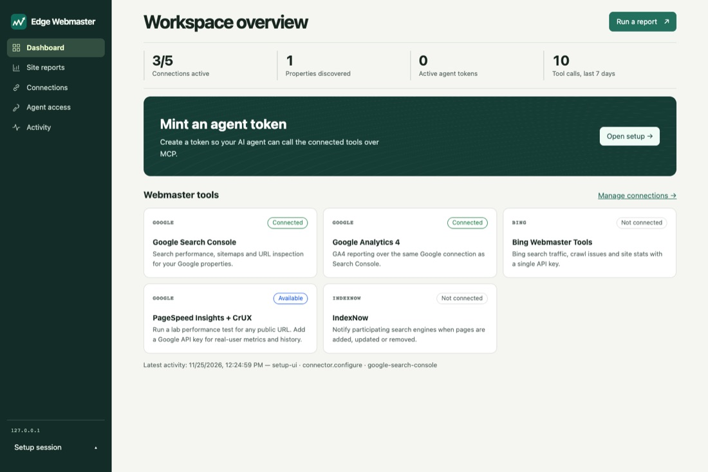

# Edge Webmaster

Run webmaster reports in your browser and give your AI agents access to the same tools. Edge Webmaster runs in your own Cloudflare account. You choose which providers to connect and which sites each agent can use.

[](https://deploy.workers.cloudflare.com/?url=https://github.com/tannerwj/edge-webmaster)

**Before you deploy:** You’ll need a GitHub account, a Cloudflare Workers Paid account for code mode, and a password manager for two secrets. Cloudflare bills usage to your account. [Cloudflare pricing](https://developers.cloudflare.com/dynamic-workers/pricing/)



## Run your first report

1. Click **Deploy to Cloudflare** above. Choose your repository, Worker name and D1 database. Keep the suggested build and deploy commands.
2. Generate two independent random 32-byte secrets. Save both in your password manager. The Worker uses `DEPLOYMENT_SECRET` to encrypt provider credentials and `SETUP_TOKEN` to unlock the dashboard.
3. Open **your new Worker URL** and enter the setup token. Under **Site reports**, choose **Mobile page speed**, enter a public page URL and click **Run report**. If Google’s shared quota is exhausted, the PageSpeed setup guide walks you through adding your own API key.
4. Open **Connections** when you’re ready to use your own data. Choose a provider, follow its setup guide, and use **Test connection** to see which properties it can access.

For manual installation, provider credentials, upgrades and rollback, see the [deployment guide](DEPLOY.md).

## Choose what to connect

| Provider | What you can do | What you need |
| --- | --- | --- |
| Google Search Console | See search queries, clicks and impressions, inspect URLs, and manage sitemaps | Google sign-in or a service account with access to your property |
| Google Analytics 4 | Report on traffic channels, compare periods and query realtime data | The same Google connection, with access to a GA4 property |
| Bing Webmaster Tools | Review search queries, page traffic and crawl issues | Bing Webmaster API key and a verified site |
| PageSpeed Insights and CrUX | Run mobile or desktop lab tests and look up real-user performance and history | Public URL for a lab test. A Google API key and sufficient traffic for CrUX |
| IndexNow | Notify participating search engines when URLs change | A verification key file hosted on each site you submit |

## Connect an agent

Open **Agent access** in your dashboard and choose how the agent should authenticate.

| Choose | When to use it | How to connect |
| --- | --- | --- |
| **Cloudflare Access** | Your agent can read reports across all connected properties | Expand **Configure Access for this installation** to set up your custom hostname and login policy. Check discovery, copy the `/mcp` URL into an OAuth-capable MCP client, and sign in. |
| **Agent tokens** | You want to restrict an agent to certain tools or sites, enable writes, or use a client that accepts bearer tokens | Name the token, choose permissions and connectors, then create it. Save the token when it appears. Under **Connect your client**, copy the setup snippet for your client. It uses `/mcp/token`. |

In **Site reports**, choose a report and property, then click **Copy task for agent**. Paste it into the connected client to run the same report there. Code mode exposes two MCP tools: `search_tools` discovers available operations, and `execute` runs JavaScript against the permitted connectors. Set `MCP_MODE=raw` to list operations directly. [Agent setup and troubleshooting](DEPLOY.md#give-an-agent-access)

## Local development

Use Node.js 24. From the repository root:

```sh
npm ci
npm run build
npx wrangler d1 migrations apply DB --local --env=""
npm run dev -- --local --env="" --var SETUP_TOKEN:local-development-only
```

Open the localhost URL printed by Wrangler and unlock it with `local-development-only`. After changing the dashboard, run `npm run build` to regenerate the HTML served by the Worker.

```sh
npm run typecheck
npm test
npm run gates -- --with-size
npm run test:e2e
```

The end-to-end suite creates a disposable local Worker and D1 database. Set `CHROME_BIN` to your Chrome executable to include desktop and mobile browser checks.

[Contributing](CONTRIBUTING.md) · [Changelog](CHANGELOG.md) · [MIT license](LICENSE)
